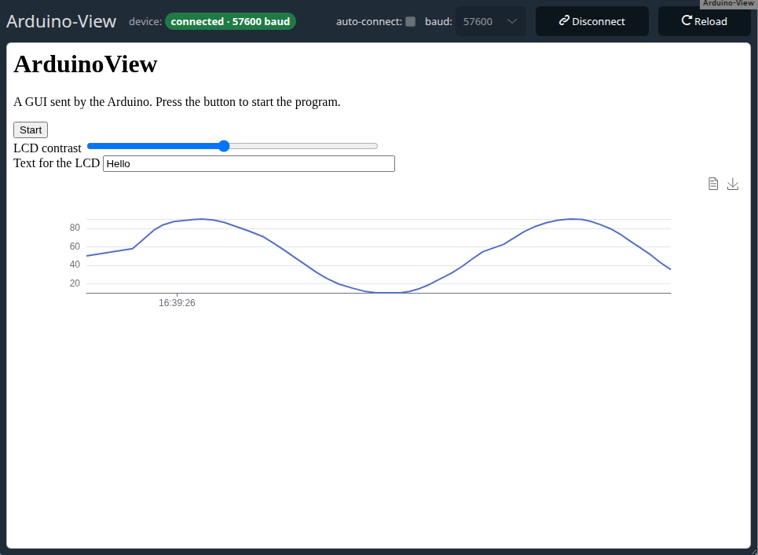

# module-arduinoview

This module shows a GUI that runs on an Arduino. The sketch sends the page (HTML, buttons, sliders, text fields,
graphs, even JavaScript) over the serial port, and everyone in the station's room sees it and can use it. Their
clicks and inputs go back to the Arduino.

The experiment lives on the Arduino: plug in a different board with a different sketch, and the same Edrys class
shows a different experiment.



See the example lab at <https://github.com/edrys-labs/lab-arduinoview/> and the
[demo on YouTube](https://www.youtube.com/watch?v=gb14CpXkoec).

## Usage

Add the module to your class with this URL:

```
https://edrys-labs.github.io/module-arduinoview/
```

The module is only shown in stations (`show-in: station`), not in normal rooms.

The **station** connects the Arduino through Web Serial. That needs Chrome or Edge (89+), Opera (76+) or Firefox
(151+), not Safari ([support table](https://caniuse.com/web-serial)). Students never touch the serial port, so
any browser works for them.

1. Open the station, choose the baud rate of your sketch and click **Connect**.
2. Choose the Arduino in the browser's port dialog.
3. About two seconds later (most Arduinos restart when the port opens), the module asks the sketch for its GUI.

Students join the station's room and see the GUI. A student who joins later gets the GUI as it is at that moment.

The header shows everyone the state of the device: **not connected**, **connecting…**,
**connected · 57600 baud**, **device lost**, or **no station** when the room has no station. Errors such as a
cancelled port dialog or a busy port appear next to it, for everyone.

The station and teachers have the connection controls (baud rate, auto-connect, Connect/Disconnect). A teacher in
the station's room uses them remotely: the station carries out the teacher's clicks, and ignores such requests
from anyone else. Students see the state and use the Arduino's GUI.

A browser only shows the port dialog after a click at the station itself. So a teacher's **Connect** works once
the station has chosen the port. Otherwise the teacher is asked to click Connect at the station once. For a
station that runs without anyone at it, turn on **auto-connect** (see below): it connects when the station opens
and when the Arduino is plugged in again.

**Reload** at the station or by a teacher asks the Arduino for its GUI again, for everyone, for example after
editing the sketch. A student's **Reload** only loads the station's current GUI again into their own view; the
Arduino is not asked.

### Settings

The baud rate and auto-connect can be set at the station or in the module settings (station config). Settings
from the module settings win. Otherwise the station remembers its last choice.

| Field         | Type    | Meaning                                                                                       |
| ------------- | ------- | --------------------------------------------------------------------------------------------- |
| `baudrate`    | select  | Baud rate of the sketch: 110 … 115200. Empty: the station's choice (default 9600)              |
| `autoconnect` | boolean | Connect when the station opens and when the Arduino is plugged in again (port chosen once before) |

```json
{ "baudrate": "57600", "autoconnect": true }
```

## Arduino

The Arduino side is the ArduinoView library by Karl Fessel (<https://github.com/kfessel/Arduinoview>). This
module adapts the browser side to Web Serial and Edrys, and draws graphs with eCharts. His introduction and
goals:

> Arduino is a micro-controller platform for education, prototyping and one of a kind projects like they often happen in arts, science and development, it is well known, taught to and learned by beginners, students, designers, scientists and professionals. Arduino has a huge community of amateurs and professionals that develop hard- and software around the platform which has already many sensors, actors, shields and other hardware and driver libraries available to it. Arduinoview will provide a way to provide a graphical user interface with an Arduino project by using the USB-serial interface of the Arduino and an interpreter running inside a web browser.
>
> __Goals__
>
> The goal of the project is to develop an simple framework to combine Arduino and a graphical user interface that will be displayed on a PC.

### Installation

Install the [Arduino IDE](https://www.arduino.cc/en/software) and copy the `ArduinoView` folder of this
repository into your Arduino libraries folder (on Windows usually
`C:\Users\<username>\Documents\Arduino\libraries`). It contains the library and the example sketches
`E00_HelloWorld` to `E05_graph`.

### Protocol

Every message is a frame: `0x01`, the text, `0x04`. The bytes `0x01`, `0x04` and `0x10` inside a frame are sent as
`0x10` followed by the byte XOR `0x40`. The library's `FrameStream` does this for you: `frm.print(...)`, then
`frm.end()`.

From the Arduino:

| Frame                        | Effect                                                                      |
| ---------------------------- | --------------------------------------------------------------------------- |
| `!!`                         | start over: clears the GUI                                                  |
| `!h<html>` / `!H<html>`      | replace / append to the content of the current element (at first the page) |
| `!w<id>`                     | make an element the current one (empty: the page)                           |
| `!S<type><id><options>`      | create a control with a 2-character id, see below                           |
| `!d<id><max>,<x>,<y>`        | add a value `y` to graph `id`, which keeps the last `max` values (0: all)   |
| `!j<javascript>`             | run JavaScript; `sendframe(text)` and `sendraw(text)` send to the Arduino   |

Types for `!S`: `b` button, `s` slider (0–255), `t` text field, `c` checkbox, `p` colour picker, `k` key
events, `G` graph, `d` inline block, `l` line break. Options are separated by `!`:

- `w<width>`, `h<height>`, `s<css>` style the control;
- `v<value>` sets its label, value, the number of values in a graph, or for `k` the events (`d`own, `u`p,
  `p`ress).

For example, `!SsVAw40%!v120` is a slider `VA`, 40% wide, at 120.

To the Arduino, when someone uses a control: `!g<id>` (button), `!g<id><value>` (slider, text, colour),
`!g<id>t` / `!g<id>f` (checkbox), `!g<id>d<key>` (key events). The module sends `!!` when it wants the GUI; the
sketch answers it with its `InitGUI()` (see the examples).

`src/stringformer.html` turns HTML into C strings for `frm.print()` and back
(`npx parcel src/stringformer.html`). The original documentation is in
[documentation/Documentation.md](documentation/Documentation.md).

The Arduino's page runs in a sandboxed iframe: its HTML and JavaScript cannot reach the module or Edrys. Only the
station's serial output is shown. Other peers cannot send output in its name. Actions in a GUI go to the Arduino
as they are, but only control values (`!g` frames) are mirrored into the other participants' GUIs.

## Messages

All peers run this module and only talk to each other (no `promiscuous` listener). Messages are signed by
edrys-Lite, so the module checks the sender's role: peers accept `update`, `replay` and `receive-buffer` only from
the station, and the station accepts `connect`, `reload` and `settings` only from teachers. For reference:

| Subject               | From → to             | Body                                         |
| --------------------- | --------------------- | -------------------------------------------- |
| `init`                | peer → station        | none: asks for state and GUI                 |
| `update`              | station → peers       | `{ baudrate, autoconnect, connected, status, error }` |
| `connect`, `reload`   | teacher → station     | none: connect/disconnect, ask the Arduino for its GUI |
| `settings`            | teacher → station     | `{ baudrate, autoconnect }`                  |
| `receive-buffer`      | station → peers       | `Uint8Array`: bytes from the Arduino         |
| `replay`              | station → joining peer | `{ complete, frames }`: the GUI so far      |
| `receivedFromSandbox` | any → all             | `{ type, data }`: an action in someone's GUI |

## Development

```bash
npm install
npm run watch   # dev server
npm run build   # builds src/ into docs/, which GitHub Pages publishes
```

`docs/` is committed: run `npm run build` and commit it together with the change in `src/`.

End-to-end tests (a station with a fake Arduino and students in real edrys-Lite browsers) are in
`edrys-module-tests`, `modules/module-arduinoview`.

## License

[MIT](LICENSE) © edrys-labs
